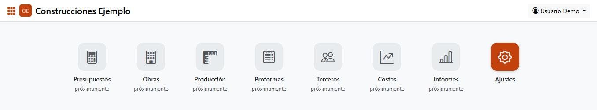
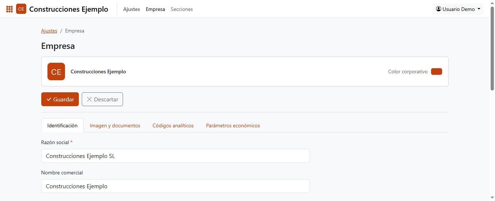
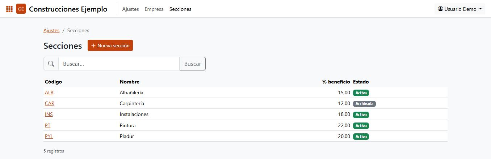
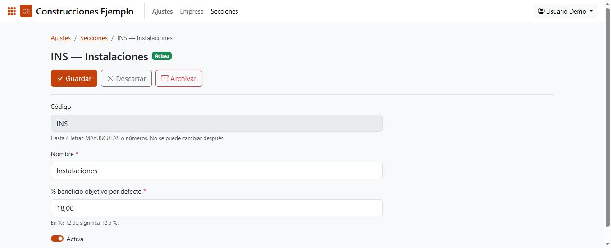

# Gestión de obra

Aplicación web de gestión de obra para **contratas y subcontratas de cualquier oficio de la construcción**: albañilería, instalaciones, carpintería, pladur, pintura…

## El problema

Una contrata o subcontrata trabaja a dos bandas: **cobra** de sus clientes y **paga** a sus subcontratas y proveedores. Lo habitual es llevarlo en hojas de cálculo sueltas: los presupuestos en un fichero, las mediciones en otro, las horas en papel. Así nadie sabe qué margen deja cada obra hasta que ya es tarde.

Esta aplicación une todo el ciclo económico de la obra, con **precios calculados desde los costes reales** de la empresa:

**presupuesto → obra → producción → valoraciones → proformas → desviación → certificación final**

## Funcionalidades

### Disponibles
- **Empresa:** datos fiscales con validación de CIF/NIF, logo y color corporativo aplicado a toda la interfaz.
- **Secciones (departamentos)** según los oficios de cada empresa, con beneficio objetivo propio y fases de avance opcionales. Los códigos no cambian una vez creados y las secciones se archivan en lugar de borrarse.
- **Usuarios y roles** (gerencia, administración, oficina técnica, jefe de obra…) con permisos por módulo.
- **Interfaz de gestión:** lanzador de módulos, listas con búsqueda, orden y totales, fichas con pestañas y barra de estado.
- **Historial de cambios:** queda registrado quién cambió qué y cuándo.

### Previstas
- **Clientes, subcontratas y proveedores**, con condiciones comerciales que se heredan de la empresa al cliente y del cliente a la obra.
- **Coste hora en tiempo real:** cada alta o baja de personal y cada gasto de estructura actualiza al momento el coste hora con el que se presupuesta. El cierre mensual registra el coste real para compararlo con el previsto.
- **Presupuestador:** banco de precios propio, importación de presupuestos en formato BC3 (FIEBDC-3) y en hoja de cálculo, descompuestos con rendimientos, márgenes, desplazamientos y avisos cuando el precio no cubre el coste.
- **Ofertas en PDF** con cláusulas reutilizables, y seguimiento comercial de las ofertas enviadas.
- **Obras:** alta de la obra al aceptar el presupuesto, con su código analítico.
- **Producción y mediciones a origen**, valoraciones periódicas propias y de subcontratas, y avance por fases.
- **Proformas** emitidas y recibidas, y cruce entre lo producido y lo facturado.
- **Desviación y margen por obra**, y certificación final.

**Estado:** en desarrollo activo. ¿Trabajas en obra y te gustaría probarla o darme tu opinión? Escríbeme por [LinkedIn](https://www.linkedin.com/in/rafael-caballero-dev).

## Capturas

Datos ficticios cargados con `python manage.py datos_demo`.


*Inicio: lanzador de módulos según el rol; los que aún no existen aparecen como «próximamente».*


*Ficha de la empresa: logo y color corporativo aplicado a toda la interfaz.*


*Secciones: lista con búsqueda, beneficio objetivo y estado (activa o archivada).*


*Ficha de sección: código que no cambia una vez creada, beneficio objetivo y opción de archivar.*

<!-- CAPTURA: presupuestador (cuando esté disponible) -->

## Tecnología

- **Backend:** Python 3.13 · Django 5.2 LTS · PostgreSQL 16
- **Interfaz:** plantillas de Django · Bootstrap 5.3 · Bootstrap Icons · HTMX · Alpine.js (servidos en local, sin compilación)
- **Cálculo:** `Decimal` en todos los importes, nunca coma flotante
- **Historial:** django-simple-history
- **Calidad:** pytest · ruff · integración continua con GitHub Actions
- **Entorno:** Docker Compose

## Ejecutar en local

Requisitos: Docker con Docker Compose.

```bash
cp .env.example .env              # y pon una clave larga en DJANGO_SECRET_KEY
docker compose up -d --build      # aplica las migraciones y arranca la aplicación
docker compose exec web python manage.py createsuperuser
```

Abre http://localhost:8001 y empieza por **Ajustes → Empresa**. El correo de pruebas se ve en http://localhost:8025.

Tests y revisión de estilo:

```bash
docker compose exec web make check
```

## Licencia

Copyright (c) 2026 Merkuryo. Todos los derechos reservados.

El código se publica **solo para consulta**: no se permite usarlo, copiarlo, modificarlo ni distribuirlo sin autorización por escrito. Consulta [LICENSE](LICENSE). Las librerías de `static/vendor/` conservan sus propias licencias.

## Autor

**Merkuryo**: [github.com/Merkuryo](https://github.com/Merkuryo)
